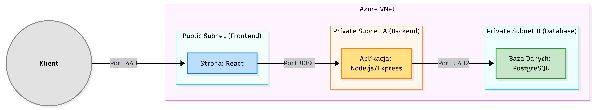

# Just do it!
Aplikacja do zarządzania zadaniami w stylu „To-Do”. Umożliwia zalogowanym użytkownikom na przeglądanie, tworzenie, zarządzanie i usuwanie swoich zadań. Oparta na architekturze 3-tier, zaprojektowana do wdrożenia w chmurze Azure.

## Wykorzystane technologie
- Cloud - Microsoft Azure
- IaC - Terraform
- Frontend - React + Vite
- Backend - Node.js + Express
- DB - PostgreSQL
- Konteneryzacja - Docker + Nginx

## Struktura repozytorium
- `/backend` - Logika aplikacji oraz REST API (Node.js/Express)
- `/config` - Pliki konfiguracyjne
  - `/config/terraform` - Infrastruktura jako kod (Terraform)
- `/docs` - Dokumentacja techniczna i schematy
- `/frontend` - Aplikacja warstwy dostępowej (React + Vite)

## Schemat Architektury


## Uruchomienie lokalne (Frontend)
1. Przejdź do katalogu warstwy webowej i skopiuj plik zmiennych środowiskowych:
   ```bash
   cd frontend
   cp .env.example .env
2. Zainstaluj zależności i uruchom serwer deweloperski:
    ```bash
    npm install
    npm run dev
3. Alternatywne uruchomienie w kontenerze Docker (Nginx):
    ```bash
    docker build -t justdoit-frontend .
    docker run --rm -p 3000:80 justdoit-frontend

## Dokumentacja REST API (`/api/tasks`)

| Metoda HTTP | Ścieżka (Endpoint) | Opis operacji | Kody odpowiedzi HTTP |
| :--- | :--- | :--- | :--- |
| GET | `/api/health` | Weryfikacja statusu serwera aplikacyjnego | 200 OK |
| GET | `/api/tasks` | Pobranie pełnej listy zadań z bazy danych | 200 OK, 500 Internal Server Error |
| GET | `/api/tasks/:id` | Pobranie szczegółów pojedynczego zadania | 200 OK, 400 Bad Request, 404 Not Found |
| POST | `/api/tasks` | Utworzenie nowego zadania po walidacji danych | 201 Created, 400 Bad Request, 500 Internal Server Error |
| PUT | `/api/tasks/:id` | Aktualizacja istniejącego zadania | 200 OK, 400 Bad Request, 404 Not Found |
| DELETE | `/api/tasks/:id` | Usunięcie zadania o podanym identyfikatorze | 200 OK, 400 Bad Request, 404 Not Found |

### Przykładowe żądanie (POST /api/tasks oraz PUT /api/tasks/:id)
```json
{
  "title": "Integracja frontendu z REST API",
  "category": "Frontend",
  "priority": "Wysoki",
  "status": "W trakcie",
  "dueDate": "2026-10-30"
}
```

### Przykładowa odpowiedź (201 Created oraz 200 OK)
```json
{
  "id": 5,
  "title": "Integracja frontendu z REST API",
  "category": "Frontend",
  "priority": "Wysoki",
  "status": "W trakcie",
  "dueDate": "2026-10-30"
}
```

## Instrukcja uruchomienia lokalnego

### 1. Baza danych (PostgreSQL w Dockerze)
```bash
docker run -d \
  --name justdoit-postgres \
  -e POSTGRES_USER=justdoit_user \
  -e POSTGRES_PASSWORD=justdoit_secret_pass \
  -e POSTGRES_DB=justdoit \
  -p 5432:5432 \
  postgres:16-alpine
```

### 2. Warstwa Backend (`/backend`)
```bash
cd backend
cp .env.example .env
npm install
npm start
```
Serwer REST API uruchamia się domyślnie pod adresem `http://localhost:8080`.

### 3. Warstwa Frontend (`/frontend`)
```bash
cd frontend
cp .env.example .env
npm install
npm run dev
```
Interfejs użytkownika dostępny jest pod adresem `http://localhost:5173`.
## Bezpieczeństwo i Hardening Chmury (Reguły NSG)

Architektura sieciowa została zabezpieczona zgodnie z zasadą najmniejszych uprawnień (**Least Privilege**) w oparciu o trzy grupy zabezpieczeń sieciowych (NSG) przypisane do osobnych podsieci VNet (`10.0.0.0/16`).

| Warstwa / NSG | Podsieć (CIDR) | Kierunek | Priorytet | Nazwa reguły | Protokół / Porty | Źródło | Cel | Akcja |
| :--- | :--- | :--- | :--- | :--- | :--- | :--- | :--- | :--- |
| **Web (`nsg-web`)** | `snet-public-web` (`10.0.1.0/24`) | Inbound | `100` | `Allow-HTTP-HTTPS-Internet` | TCP `80, 443` | `Internet` | `*` | **Allow** |
| **Web (`nsg-web`)** | `snet-public-web` (`10.0.1.0/24`) | Inbound | `200` | `Deny-Management-SSH-RDP` | TCP `22, 3389` | `*` | `*` | **Deny** |
| **Web (`nsg-web`)** | `snet-public-web` (`10.0.1.0/24`) | Inbound | `4000` | `Deny-All-Other-Inbound` | `*` / `*` | `*` | `*` | **Deny** |
| **Web (`nsg-web`)** | `snet-public-web` (`10.0.1.0/24`) | Outbound | `65000` | `AllowVnetOutBound` (domyślna Azure) | `*` / `*` | `VirtualNetwork` | `VirtualNetwork` | **Allow** |
| **Web (`nsg-web`)** | `snet-public-web` (`10.0.1.0/24`) | Outbound | `65500` | `DenyAllOutBound` (domyślna Azure) | `*` / `*` | `*` | `*` | **Deny** |
| **App (`nsg-app`)** | `snet-private-app` (`10.0.2.0/24`) | Inbound | `100` | `Allow-App-From-Web-Only` | TCP `8080` | `10.0.1.0/24` | `*` | **Allow** |
| **App (`nsg-app`)** | `snet-private-app` (`10.0.2.0/24`) | Inbound | `200` | `Deny-Management-SSH-RDP` | TCP `22, 3389` | `*` | `*` | **Deny** |
| **App (`nsg-app`)** | `snet-private-app` (`10.0.2.0/24`) | Inbound | `4000` | `Deny-All-Other-Inbound` | `*` / `*` | `*` | `*` | **Deny** |
| **App (`nsg-app`)** | `snet-private-app` (`10.0.2.0/24`) | Outbound | `65000` | `AllowVnetOutBound` (domyślna Azure) | `*` / `*` | `VirtualNetwork` | `VirtualNetwork` | **Allow** |
| **App (`nsg-app`)** | `snet-private-app` (`10.0.2.0/24`) | Outbound | `65500` | `DenyAllOutBound` (domyślna Azure) | `*` / `*` | `*` | `*` | **Deny** |
| **Data (`nsg-db`)** | `snet-private-db` (`10.0.3.0/24`) | Inbound | `100` | `Allow-DB-From-App-Only` | TCP `5432` | `10.0.2.0/24` | `*` | **Allow** |
| **Data (`nsg-db`)** | `snet-private-db` (`10.0.3.0/24`) | Inbound | `110` | `Allow-DB-Internal-Subnet` | `*` / `*` | `10.0.3.0/24` | `10.0.3.0/24` | **Allow** |
| **Data (`nsg-db`)** | `snet-private-db` (`10.0.3.0/24`) | Inbound | `120` | `Allow-Azure-LoadBalancer` | `*` / `*` | `AzureLoadBalancer` | `*` | **Allow** |
| **Data (`nsg-db`)** | `snet-private-db` (`10.0.3.0/24`) | Inbound | `200` | `Deny-Management-SSH-RDP` | TCP `22, 3389` | `*` | `*` | **Deny** |
| **Data (`nsg-db`)** | `snet-private-db` (`10.0.3.0/24`) | Inbound | `4000` | `Deny-Direct-From-Web-And-All` | `*` / `*` | `*` | `*` | **Deny** |
| **Data (`nsg-db`)** | `snet-private-db` (`10.0.3.0/24`) | Outbound | `65000` | `AllowVnetOutBound` (domyślna Azure) | `*` / `*` | `VirtualNetwork` | `VirtualNetwork` | **Allow** |
| **Data (`nsg-db`)** | `snet-private-db` (`10.0.3.0/24`) | Outbound | `65500` | `DenyAllOutBound` (domyślna Azure) | `*` / `*` | `*` | `*` | **Deny** |

### Dodatkowe mechanizmy Hardeningu PaaS i HTTP
- **Izolacja bazy danych:** `public_network_access_enabled = false` na Azure PostgreSQL Flexible Server oraz połączenie z backendu szyfrowane SSL (`DB_SSL=true`).
- **Szyfrowanie w locie (TLS 1.2+):** Wymuszone `https_only = true` i `minimum_tls_version = "1.2"` na obu usługach Azure App Service (automatyczne przekierowanie `HTTP 80 -> HTTPS 443` kodem `301 Moved Permanently`).
- **Ograniczenie powierzchni ataku:** Wyłączony dostęp `FTPS` (`ftps_state = "Disabled"`), zablokowane porty zarządcze `22` i `3389`, wyłączony nagłówek `X-Powered-By`, restrykcyjna polityka `CORS` ograniczona wyłącznie do domeny HTTPS frontendu oraz nagłówki bezpieczeństwa `Strict-Transport-Security`, `X-Content-Type-Options: nosniff` i `X-Frame-Options: DENY`.
